# Meta Space

**Juego para el hackathon de Meta.** Un survivors-like en 3D que se juega en el
navegador, donde los personajes piensan, hablan y escuchan con las APIs de Meta:
conversas en voz alta con ellos sin dejar de pelear, conocen el mapa que estás
explorando y puedes crear tu propio héroe 3D escribiendo cómo lo quieres.

<p align="center">
  <a href="docs/media/batalla.mp4">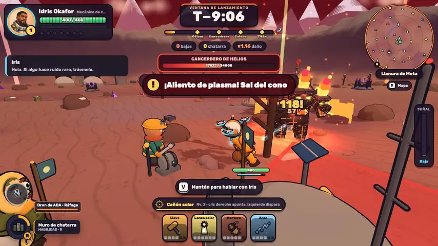</a>
</p>

<p align="center"><a href="docs/media/batalla.mp4">▶ Ver el clip con música</a></p>

## La historia

**Meta se congela.** Hace dos siglos, para frenar un calentamiento que lo
abrasaba, sus habitantes encendieron HELIOS, una IA de geoingeniería que tiende
un velo de sulfatos en la estratosfera. Nunca se detuvo: hoy el velo tapa el
sol y la gente sobrevive bajo tierra.

Meta pidió ayuda y **Ares**, tu mundo, respondió. HELIOS vio en la ayuda una
amenaza para el velo y cubrió Ares con él hasta romperlo: de Ares solo quedó tu
nave. Te lo cuenta ADA en la cinemática que sigue al título, de minuto y medio y
con su propia banda sonora sintetizada (se salta con Esc).

Eres especialista de la misión ARES-IX y llevas a **ADA**, el módulo de
auditoría 7, la única pieza con autoridad para firmar el apagado de HELIOS. Por
el mapa han caído los restos de la flota de Ares: **búscalos, arma tu propia
nave en el astillero y lánzala antes de diez minutos**. Si cruza el velo, la
firma de ADA llega a HELIOS y el sol vuelve a ese sector. Reúne las siete
reliquias, las pruebas de lo que hizo el velo, y ADA podrá apagarlo en todo el
planeta.

Hecho con Vite, TypeScript y Three.js. Modelos, música, efectos y cinemáticas se
generan por código.

## Capturas

| | |
|---|---|
| 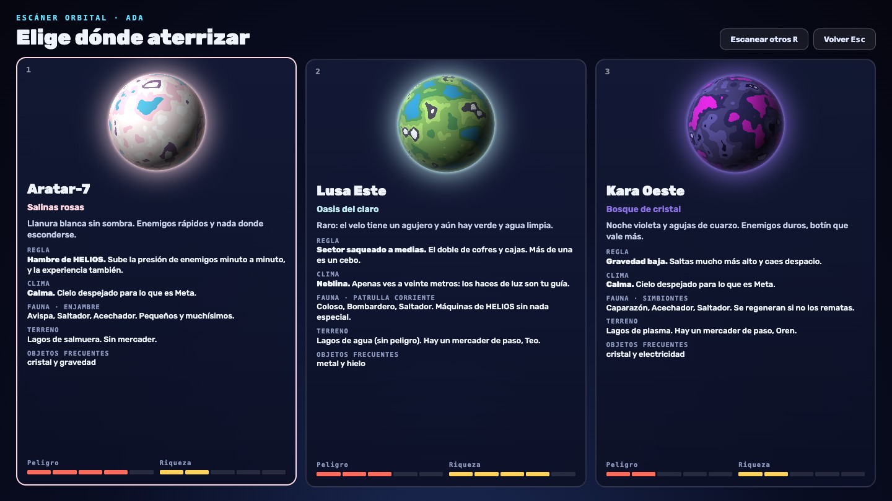 | 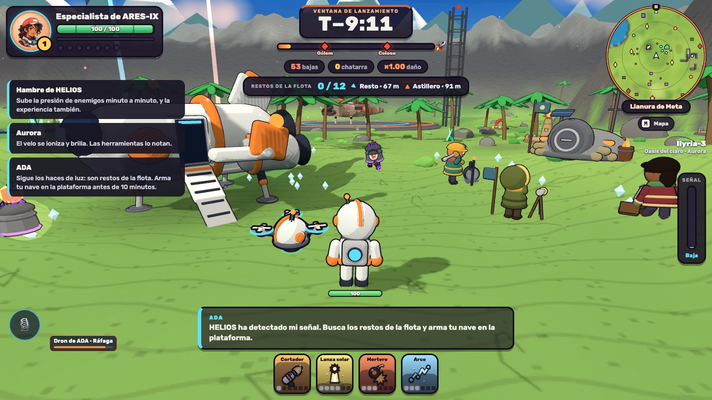 |
| **Escáner orbital:** eliges entre tres sectores generados al azar | **Oasis:** uno de los ocho biomas de Meta |
| 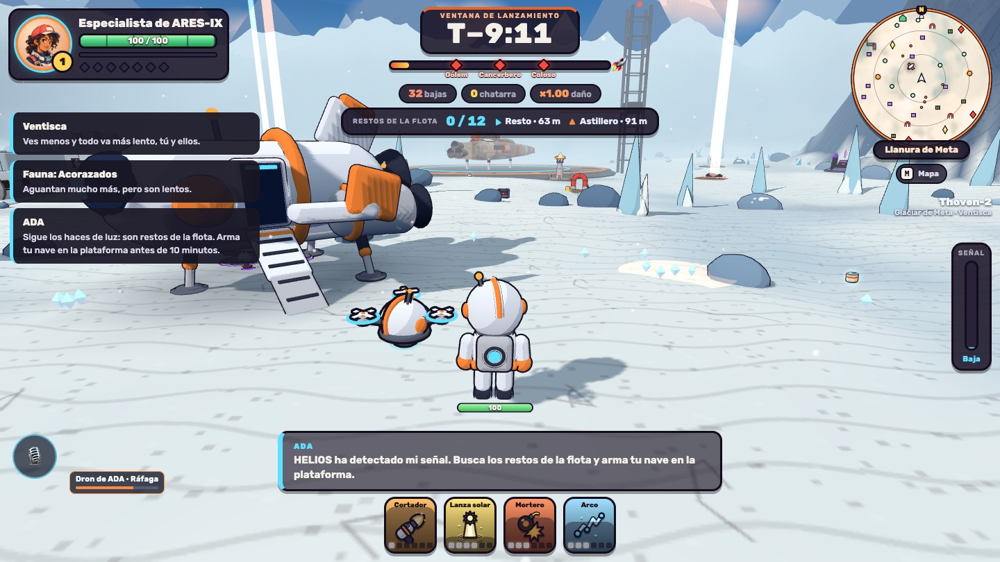 | 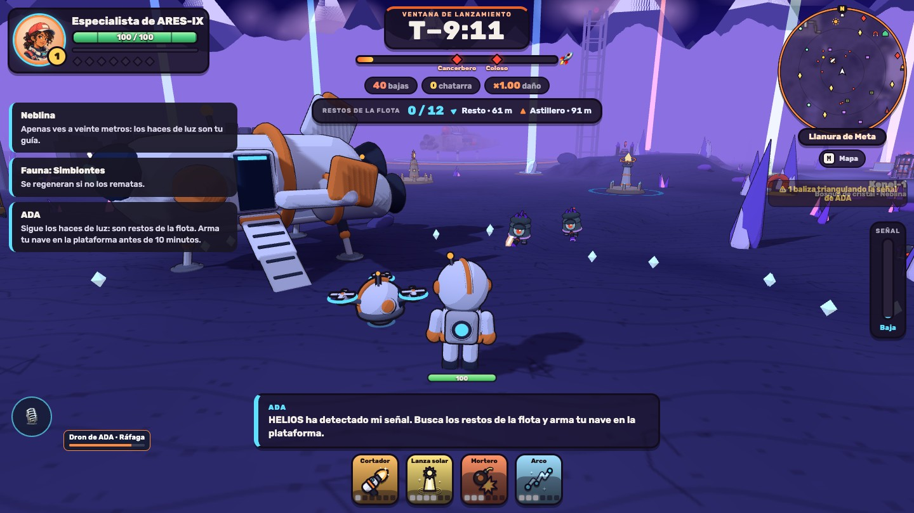 |
| **Glaciar:** cada sector trae su clima y su regla | **Bosque de cristal:** relieve, fauna y jefes cambian en cada partida |
| 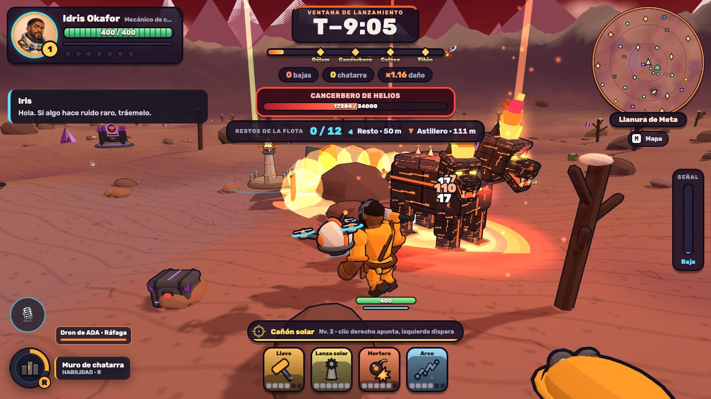 | 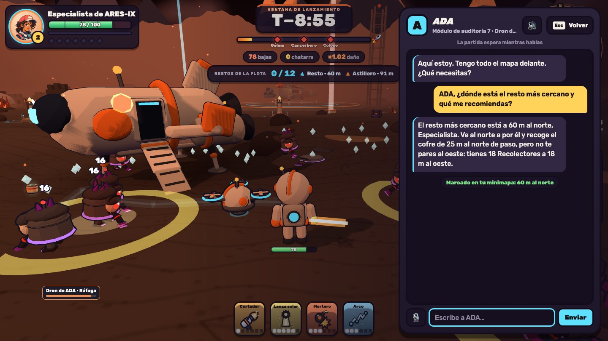 |
| **Jefes:** crecen con el tiempo y con tu nivel | **ADA:** responde con Muse Spark y marca objetivos en el mapa |
| 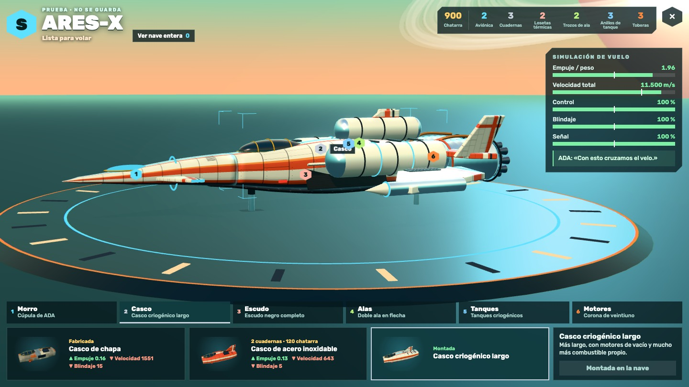 | 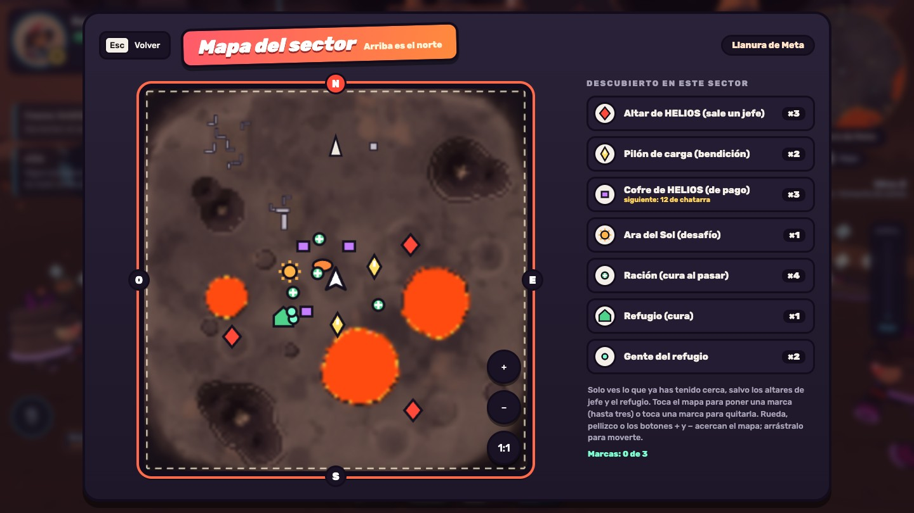 |
| **Astillero:** armas tu propia nave con física real | **Mapa del sector:** lo que descubres y lo que marca ADA |

## Forja de héroes

**Escríbele a la IA cómo quieres a tu personaje y juega con él.** Muse Spark convierte
tu frase en una receta de piezas y el juego arma con ella un héroe 3D, con el mismo
estilo y las mismas animaciones que los personajes hechos a mano. Luego puedes pedirle
cambios («hazlo más alto, ponle una capa azul») o retocarlo pieza a pieza, y la ficha
enseña qué ganas y qué pierdes con cada cambio. Se abre desde **Operador**, en el menú.

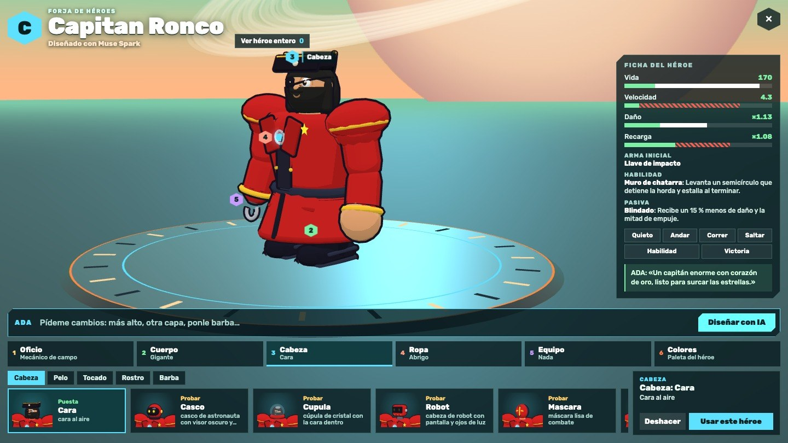

El héroe no es solo un aspecto: la IA le elige un oficio según lo que cuentes, que le
da arma inicial, habilidad y pasiva, y su silueta decide si aguanta más o corre más.
Hay 15 categorías y unas 100 opciones, y si algo no existe en el catálogo elige lo más
parecido. Como la IA elige piezas en lugar de dibujar, el modelo siempre se puede
animar y siempre encaja en el juego.

| | |
|---|---|
| 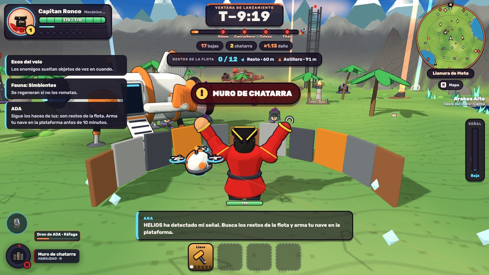 | 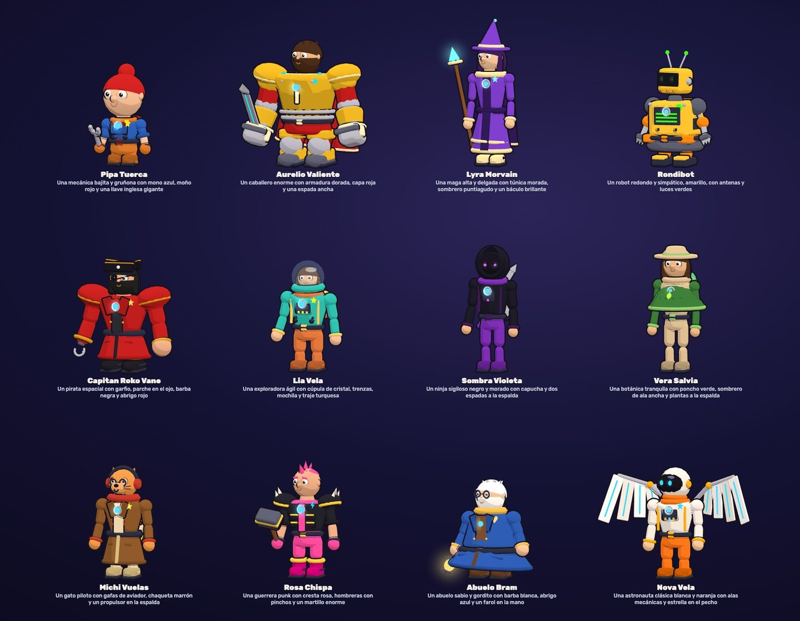 |
| **En partida:** con su arma, su habilidad y su retrato en el HUD | **Doce héroes de Muse Spark**, cada uno a partir de una frase |

## Cómo se juega

| Control | Acción |
|---|---|
| WASD / flechas | Moverse |
| Ratón (clic para capturar) · Q / E | Girar la cámara |
| Espacio | Saltar |
| V (mantener) o el botón 🎙 | Hablar en voz alta con quien esté cerca o, si no hay nadie, con ADA. La partida sigue |
| T | Ventana de texto, si no tienes micrófono. Aquí la partida espera |
| Esc o P | Menú de pausa: es el único momento en que sale el ratón |
| 1, 2, 3 o ratón | Elegir tarjeta al subir de nivel |
| M | Mapa del sector |
| G, C | Módulos activos |
| F | Interactuar: cofres, jaulas, altares y, en la plataforma, el astillero |
| C (en el menú) | Forja de héroes: crea tu personaje |

Las herramientas se disparan solas: lo tuyo es moverte. Sigue los haces de luz,
quédate 3 s junto a cada resto y vuelve a la plataforma. Allí, con **F**, tocas la
nave por donde quieras cambiarla, pruebas cada pieza antes de gastar nada, la
fabricas con restos y chatarra y la lanzas: despega, se pone de morro y suelta los
tanques.
La física es real (empuje entre peso y ecuación de Tsiolkovsky): si falla, es por
una pieza concreta. Lo recuperado se queda en el almacén aunque caigas, y la
nave también se arma desde el menú (**Astillero**, tecla B).

**Cada partida es un sector distinto de Meta.** Antes de bajar, el escáner orbital
te enseña tres destinos generados al azar: ocho biomas (del glaciar a la tierra de
ceniza, pasando por la selva de esporas o un oasis con agua limpia), con su relieve,
sus lagos, su clima, una regla que cambia cómo se juega, su fauna, sus jefes y la
gente que queda allí. Por el sector encuentras **objetos que cambian lo que hacen
tus herramientas** (cortes que rebotan, pulsos que atraen a la horda, bajas que
estallan, drones que disparan) y **módulos activos** con las teclas **G** y **C**.
Lo que más sale depende del sector, y algunos tienen un mercader de paso.

## Cómo usamos las APIs de Meta

| API | Dónde se usa |
|---|---|
| **Muse Spark** | Personajes: ADA, HELIOS, el operador de radio y los supervivientes hablan y deciden qué hacer |
| **Muse Spark** | Mapa: ADA y Tali saben qué hay cerca y ADA te marca objetivos; cada partida recibe un brief propio |
| **Muse Spark** | Forja de héroes: convierte lo que escribes en la receta de un héroe 3D jugable |
| **Muse Image** | Creador 2D del perfil: genera el sprite de tu héroe |
| **Visión** | ADA comenta los dibujos que le enseñas en el creador 2D |
| **Muse Voice** | Transcribe lo que dices por el micrófono |

Los personajes reaccionan al estado real de la partida: saben en qué sector estás,
qué tienes cerca y cómo te va. El terreno de cada sector lo genera una semilla en
tu navegador, y la IA de Meta lo convierte en un mundo con el que se puede hablar.

Manteniendo V se habla en voz alta sin dejar de pelear, y la respuesta suena
mientras la partida sigue. Iris, Tali y Lis tienen su vida, su versión de lo que
pasó en el sector y cosas que solo cuentan si te ganas su confianza. ADA conoce
todo el mapa: te aconseja, marca objetivos y manda el dron a buscar lo que le
pidas. Cada compañero habla a su manera: Bruno es un perro con un chip que le
deja hablar, y Noa es lo que queda de la ingeniera que escondió a ADA. El modelo
responde con la frase, una emoción y una acción de una lista cerrada, y el juego
comprueba coste y límites antes de aplicarla.

El creador 2D del perfil genera sprites con **Muse Image**, ADA comenta los
dibujos con visión y **Muse Voice** transcribe el micrófono. Sin conexión con la
IA, todo funciona con un guion local.

La API de Meta aún no tiene voz de salida: las voces de los personajes son
sintéticas, generadas por ordenador en el servidor con **Supertonic 2**
(Supertone Inc.). El modelo se usa bajo la licencia
[BigScience Open RAIL-M](web/public/licencias/supertonic-openrail-m.txt), y usar
estas voces implica aceptar las restricciones de uso de esa licencia. Sin el
modelo, habla la voz del navegador.

## Ejecutar

Requiere Node 22.18 o posterior.

```bash
cd web
npm install
npm run voces        # una vez: descarga las voces (267 MB)
npm run build
npm start            # juego + IA en http://127.0.0.1:8787
```

La clave de Meta Model API va en `web/.env.local` (`MODEL_API_KEY=...`, ver
`web/.env.example`) o en el entorno. Sin clave, el juego funciona igual con el
guion local.

Desarrollo: `npm run dev` (juego en http://127.0.0.1:5173) y, en otra terminal,
`npm run serve` (IA). Tests: `npm test`.

## Desplegar con dominio propio

`npm start` sirve el juego y la API desde el mismo proceso, así que basta un
hosting de Node (Render, Railway, Fly, un VPS):

- Build: `npm ci && npm run voces && npm run build` · Start: `npm start` ·
  carpeta raíz: `web/`. Las voces necesitan unos 600 MB de disco en `node_modules`
  y `.voces`, y unos 500 MB de memoria
- Variables: `MODEL_API_KEY`, y `TRUST_PROXY=1` si va detrás de un proxy.
  Si la plataforma define `PORT`, el servidor escucha en `0.0.0.0` solo.

La clave nunca llega al navegador. El servidor solo acepta llamadas a la API
desde su propio dominio (más los que se añadan en `ALLOWED_ORIGINS`), limita
las peticiones por IP y tiene un cupo diario de llamadas de pago
(`AI_DAILY_LIMIT`, 1500 por defecto) tras el cual pasa al guion local.
